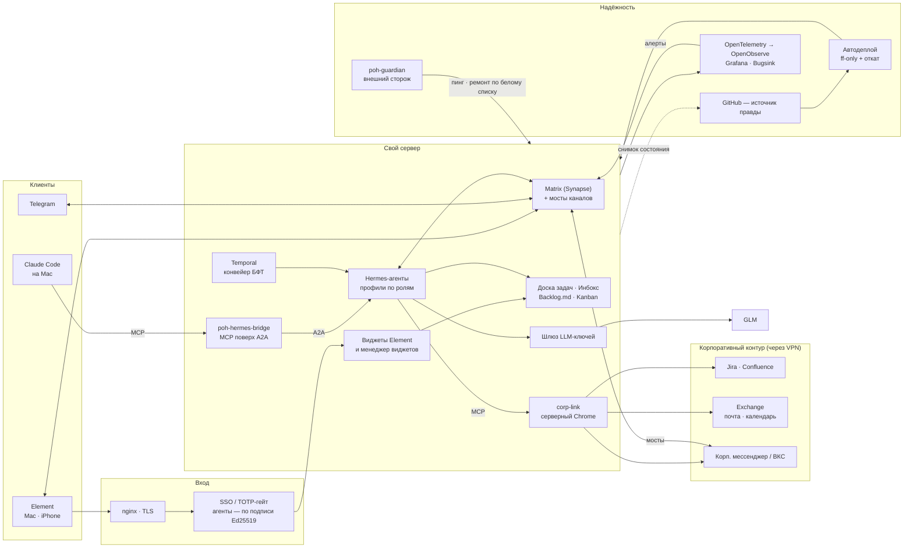

# po-helper-org

> **Система знает о смещении планов и сроков раньше, чем руководство спросит.**
> И подсвечивает, какие команды испытывают сложности, — до того как это станет
> эскалацией.

Корпоративный руководитель в роли Product Owner делегирует часть своих функций
ИИ-агентам и предсказуемо достигает целей — с надёжностью, за которую платят.

Это манифест организации и карта того, что уже работает. Каждый репозиторий служит
одной из четырёх функций ниже либо обеспечивает их производство.

**Сайт методологии:** [po-helper-org.github.io/docs](https://po-helper-org.github.io/docs/) ·
**Витрина системы:** [aleksishmanov.ru/po-system](https://aleksishmanov.ru/po-system/)

## Что работает сегодня

Рабочее место PO собрано в мессенджере Element: каждая возможность — виджет в комнате
или бот, с которым говорят обычным языком. За виджетами стоят ИИ-агенты на своём сервере.

| Возможность | Что получает PO |
|---|---|
| **Инбокс** | Заметка текстом или голосом превращается в обещания: кто, что, к какому сроку. Вкладки «Сегодня / Я обещал / Мне обещали», поручение команде одной фразой. |
| **Доска ИИ-агентов** | Задачи агентам ставятся и принимаются как людям: статус, вопросы агента в треде, приёмка результата. Любая работа живёт внутри инициативы. |
| **Спринты одним взглядом** | Детерминированный отчёт по спринтам команд, бизнес-отчёт «ФАКТ \| спринт» для комитета, Гантт инициатив квартала, дейли с блокерами, PDF-отчёт каждое утро. Рядом — агент, который превращает замечания к отчёту в правки задач. |
| **Цели и OKR** | Реестр целей и KR квартала с ответственными (люди и агенты) и ежедневной заметкой о движении по каждому KR. |
| **Требования (БФТ)** | Бэклог требований по стадиям, доски команд, бот, который готовит БФТ и сдаёт его комментарием или страницей в вики; Service Blueprint по готовому БФТ. |
| **Почта, календарь, созвоны** | Корпоративная почта и календарь Exchange в одном окне без VPN на устройстве: ответ после ✅, встреча в ТОП-3 свободных окна, созвон в Element, документ-рефлексия после звонка. |
| **Лента и коммуникации** | Групповые чаты корпоративного мессенджера и Telegram приходят в Element как лента новостей с алертами на упоминания и ответом из треда. |
| **Корпоративные ссылки** | Ссылки на корпоративные системы открываются в защищённом серверном браузере прямо из чата; короткие ссылки и журнал «кто и когда открыл». |

## Архитектура

**Как это устроено**

- **Интерфейс — мессенджер.** Element и Matrix — единая оболочка: виджеты через Widget API,
  боты в комнатах, мосты приводят Telegram и корпоративный мессенджер в одно место.
- **Агенты — Hermes.** Один gateway, профили по ролям (Инбокс, доска, календарь, БФТ,
  спринты, лента). Модель — GLM через свой шлюз ключей с лимитами на клиента.
  Claude Code подключается с Mac через `poh-hermes-bridge`: MCP-инструменты поверх протокола A2A.
- **Доступ по уровням.** Чтение — свободно, запись людям и в трекеры — только после
  подтверждения владельца (✅), критичные действия — по явному гранту. Вход людей — через
  SSO, вход агентов — по подписи Ed25519 без пароля.
- **Корпоративный контур изолирован.** Корпоративные системы доступны только через
  серверный браузер и VPN на сервере; на устройства PO VPN не нужен.
- **Инфраструктура как код.** GitHub — единственный источник правды: автодеплой тянет
  `main` (только fast-forward, откат при сбое), ночной снимок сервера возвращается в git.
  Правок руками на сервере нет.
- **Наблюдаемость.** OpenTelemetry → OpenObserve (логи, метрики, трейсы, SLO), Grafana
  как виджет, Bugsink для ошибок; алерты приходят в Matrix и GitHub Issues. Внешний
  сторож `poh-guardian` пингует сервер снаружи и чинит по белому списку.
- **Память организации — Cortex.** Markdown в git, у каждого утверждения есть источник
  и уровень доказательности; реестр целей — экземпляр Cortex.
- **Коробка `poh-box`.** Та же система как поставка в `docker compose`: ядро (Matrix,
  доска, Инбокс, менеджер виджетов, Hermes, SSO) плюс расширения по манифесту.
  Образы подписаны, обновления коробка тянет сама, без входящих портов.

## Четыре функции

### 1. Снятие неопределённости

Хотелки бизнеса — реплика в чате, письмо, устная просьба — последовательной
обработкой превращаются в точный и предсказуемый план работ. Не «сгенерируй
документ», а управляемый диалог со STOP-гейтами: контекст → проблема → ставки →
adversarial-проверка → роадмап. Каждое утверждение прослеживается до источника.

*Меряется:* временем до ясности и долей `[УТОЧНИТЬ]` в согласованном артефакте.

### 2. Границы и приёмка (БФТ)

Точно описанные границы задачи и план её демонстрации. Продуктовым и бизнесовым
языком, понятным нетехническим командам, — не техническим. Что входит в объём,
что не входит, как поймём, что сделано.

*Меряется:* готовностью требований и числом возвратов от команд-исполнителей.

### 3. Контракт с командой (Гантт)

Система получает на вход гантт и сроки от лидов команд. Система определяет, что
должно быть сделано и по каким критериям принимается. Реальные сроки и
техническая реализация приходят от техлидов — система их не выдумывает.

*Меряется:* полнотой гантта и покрытием зависимостей между командами.

### 4. Риски и раннее предупреждение

Система понимает зависимости. Кто-то потерял сроки, изменился объём — сигнал
приходит вместе с последствиями для каждой цели в зоне управления. Не «команда
опаздывает», а «цель X сдвигается на Y из-за зависимости Z».

*Меряется:* лид-таймом сигнала — сколько дней между отклонением и эскалацией.

## Границы делегирования

Функция снимается с человека только там, где результат воспроизводим и
наблюдаем. Остальное остаётся за человеком — явно, а не по умолчанию.

| Система владеет | Человек владеет |
|---|---|
| Цель, объём, критерии приёмки | Оценка трудоёмкости и реальные сроки |
| Карта зависимостей между командами | Техническая реализация и архитектура |
| Сигнал отклонения и его последствия для целей | Решение о сдвиге, переговоры с командами |
| Форма артефакта, прослеживаемость каждого факта | Приоритет при конфликте целей |

## Карта организации

Пять групп. Репозиторий, который не служит ни одной из них, переводится в архив.

### 1. Методология

| Репозиторий | Что это |
|---|---|
| [docs](https://github.com/po-helper-org/docs) · [сайт](https://po-helper-org.github.io/docs/) | Сайт методологии: **PAF Product Ops для корпоративного PO**, AI-Native Discovery, Трансформация PAF |
| [landing](https://github.com/po-helper-org/landing) · [сайт](https://aleksishmanov.ru/po-system/) | Витрина системы: методология и каталог виджетов |
| [poh-cortex](https://github.com/po-helper-org/poh-cortex) | Кортекс: память организации для ИИ-агентов — правила как данные, лестница доказательств, утилита `cortex` |
| [poh-memory-engine](https://github.com/po-helper-org/poh-memory-engine) | Движок памяти: Markdown → граф знаний + вектор (прототип) |
| [research-as-investment](https://github.com/po-helper-org/research-as-investment) | Исследование идей как инвестиция: ценность информации, уровни глубины L0–L4, шкала доказательств |
| [po-agent](https://github.com/po-helper-org/po-agent) | Консультант PO по управленческим решениям (Senior/Lead) |

### 2. Навыки и агенты PO (открытые)

| Репозиторий | Функции | Что делает |
|---|---|---|
| [poh-okr-agent](https://github.com/po-helper-org/poh-okr-agent) | 1 · 4 | Ретро → OKR → roadmap → декомпозиция → квартальный план → экватор (`.md` + `.pptx`) |
| [poh-bft-writer](https://github.com/po-helper-org/poh-bft-writer) | 2 | Эпик → корпоративный БФТ: само-индексация воркспейса, проблема, концепты, дебаты, черновик, валидация |
| [poh-bft-box](https://github.com/po-helper-org/poh-bft-box) | 2 | «Коробка БФТ»: оркестратор подготовки БФТ на Temporal с гейтами качества и MCP-интерфейсом |
| [poh-blueprint-writer](https://github.com/po-helper-org/poh-blueprint-writer) | 2 · 3 | Service Blueprint по готовому БФТ: история через экраны, карта инициативы, план релиза |
| [poh-sprint-agents](https://github.com/po-helper-org/poh-sprint-agents) | 3 · 4 | Скрам-мастер-агент: планирование, актуальный отчёт, бизнес-отчёт, блокеры, инсайты |
| [poh-sprint-report](https://github.com/po-helper-org/poh-sprint-report) | 3 · 4 | Автономный PDF-отчёт команды по спринту: прогноз, пульс, решения на сегодня, сроки, эпики |
| [poh-backlog-skills](https://github.com/po-helper-org/poh-backlog-skills) | 3 · 4 | Гигиена беклога: правила как данные, вердикты, план действий (прототип) |
| [poh-morning-status](https://github.com/po-helper-org/poh-morning-status) | 4 | Утренний бриф PO `/morning`: детерминированный сбор снимка, отчёт |
| [poh-dev-daily](https://github.com/po-helper-org/poh-dev-daily) | 3 | Дейлик разработчика через агента: рассказ → сверка с Jira и git → статусы после одного «да» |
| [poh-okr-plugin](https://github.com/po-helper-org/poh-okr-plugin) | 1 · 4 | Раздел «Управление целями» для DeepSeek Harness |

### 3. Контур производства

Чем организация строит саму себя. Агенты не вызывают друг друга — они общаются через
состояние GitHub ([протокол](https://github.com/po-helper-org/.github/blob/main/AGENT-PROTOCOL.md)).

| Репозиторий | Что делает | Статус |
|---|---|---|
| [poh-issue-agents](https://github.com/po-helper-org/poh-issue-agents) | Жизненный цикл Issue как Temporal-workflow: БФТ → системные требования | развивается; стадии разработки и релиза заморожены |
| [poh-howtodemo-agent](https://github.com/po-helper-org/poh-howtodemo-agent) | Приёмка по сценарию HowToDemo, вердикт с доказательствами | прототип |
| [poh-pr-agents](https://github.com/po-helper-org/poh-pr-agents) | Авто-ревью PR: PR-Agent + GLM в GitHub Actions или self-hosted | поддерживается |
| [poh-sysreq-agent](https://github.com/po-helper-org/poh-sysreq-agent) | Агент системного аналитика: системные требования по концепту | заморожен |
| [poh-demo-checkout](https://github.com/po-helper-org/poh-demo-checkout) | Демонстрационный сервис — полигон контура | фикстура |
| [poh-harness](https://github.com/po-helper-org/poh-harness) · [poh-infra](https://github.com/po-helper-org/poh-infra) | Дистрибутив DeepSeek Harness под ключ; docker-compose инфраструктуры | поддерживаются |
| [poh-guardian](https://github.com/po-helper-org/poh-guardian) | Хранитель сервера: внешний пинг, ИИ-агент ремонта, Telegram | работает |
| [poh-scheduller](https://github.com/po-helper-org/poh-scheduller) | Односторонняя синхронизация Exchange → Google Calendar без лишних уведомлений | отдельный инструмент |

### 4. Серверный контур PO (приватные репозитории)

Рабочая система из раздела «Что работает сегодня». Исходники закрыты: в них корпоративные
интеграции.

- **Платформа:** инфраструктура сервера как код и ADR (`server-infra`), коробочная поставка
  (`poh-box`), конфигурация агентов Hermes (`hermes-config`), мост Claude Code → Hermes
  (`poh-hermes-bridge`), наблюдаемость (`poh-observability`), дизайн-система экранов
  (`poh-design-system`), оркестратор сессий Claude Code (`cc-builder-orchestrator`).
- **Инбокс и задачи:** `poh-widget-inbox`, доска агентов `poh-widget-harness`, Jira в Element
  `poh-widget-jira`, Telegram-бот задач.
- **Спринты:** `poh-widget-sprint-observe`, `poh-widget-sprint-business`, `poh-widget-sprint-gantt`,
  `poh-sprint-daily`, `poh-sprint-agent`.
- **Цели:** `poh-widget-okr` и реестр `po-okr-registry`.
- **Требования:** `poh-widget-bft`, `poh-confluence-watch`.
- **Коммуникации:** мосты каналов `comunager-hub`, лента `poh-widget-news`, коннекторы
  мессенджеров, `poh-support-desk`.
- **Почта, календарь, созвоны:** `poh-widget-mail`, `poh-mail-core`, `poh-widget-calendar`,
  `poh-widget-meet`, `poh-widget-call-reflection` + `call-reflection-skills`.
- **Корпоративный доступ:** `corp-link`, `poh-widget-linkshort`, менеджер виджетов `poh-widget-manager`.

Описание практик — в разделе [«Практика в организации»](https://po-helper-org.github.io/docs/paf-product-ops/practice/) сайта.

### 5. Архив

Заменены и не используются; история доступна только для чтения.

- **Публичные:** `poh-helper` (монолит-предшественник), `poh-developer-agents`,
  `poh-delivery-agent`, `poh-pr-closer`, `poh-security-agent` (стадии контура производства),
  `poh-news`, `poh-feed-poc` (заменены лентой), `poh-po-task` (заменён Инбоксом),
  `dsh-communication-plugin` (заменён мостами каналов).
- **Приватные:** ранние отчёты спринтов и реестр команд (заменены виджетами спринтов),
  `poh-mob-commands`, `poh-focus-mode-plugin`, `poh-scheduller-archive-private`,
  `poh-cc-orchestrator` (заменён `cc-builder-orchestrator`), агентный VPN-клиент.

## Видимость

Методология, навыки и открытые инструменты — публичные. Серверный контур с корпоративными
интеграциями — приватный. Перед любым переводом приватного репозитория в публичный
выполняется очистка от корпоративных идентификаторов, имён и адресов.

## Принципы

- **Контракт, не догадка** — сроки и трудоёмкость берутся у техлидов. Система
  задаёт «что» и критерии приёмки, но не выдумывает «когда».
- **Надёжность прежде мощности** — делегируют только то, что воспроизводимо и наблюдаемо.
- **Процесс как код** — продуктовые практики выражены пайплайнами, а не ручными шагами.
- **Привязка к целям** — ценность в движении к OKR, не в объёме вывода.
- **Каждый факт ← источник** — нет источника, значит `[УТОЧНИТЬ]`. Ноль
  выдуманного в согласованном артефакте.
- **Человек подтверждает запись** — агент читает свободно, но пишет людям и в трекеры
  только после ✅ владельца.
- **Self-hosted first** — свои модели и инфраструктура, данные под контролем.
